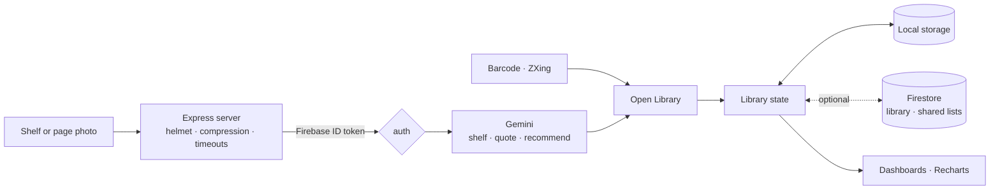

<div align="center">


<p>
  
  
  
  
</p>

<p><em>Digitise your physical library and track your reading: photograph a shelf or scan a barcode,<br>
log sessions with smart pacing and streaks, and read in a full-screen ambient mode.</em></p>

</div>


## The idea

Your books are on a wall, not in an app, and typing them in one by one is where every reading tracker loses you. BookShelf starts from a photo: point the camera at a shelf and every readable spine comes back, matched against Open Library, with an honest badge for the ones it is not sure about. From there it is a calm reading companion: sessions, pacing, streaks, goals and a soundscape to read to.

> **Unsure is a valid answer.** Each scanned spine comes back as *matched*, *review* or *unknown*. Review opens a sheet with the candidate editions side by side; unknown goes to a manual search. Nothing guessed is silently added.


## Features

| | |
|---|---|
| **Shelf scan** | A server-side Gemini vision endpoint reads every spine in a photo; results are matched on Open Library with confidence levels. |
| **ISBN / QR scan** | Live barcode decoding with ZXing (or the browser's Barcode Detection API), resolved against Open Library. |
| **Quote scan** | Photograph a page and save the quote to the book. |
| **Review and editions** | A sheet to confirm uncertain matches, pick the right edition, or compare two books. |
| **Manual search** | Debounced Open Library search, plus a natural-language library search ("unread sci-fi", "reading now"). |
| **Library and shelves** | Unread, Reading and Read, named shelves shown as spine strips, a reading queue, filters and sorting. |
| **Smart pacing** | Time left to finish, from the seconds you actually spend per percent. |
| **Streaks and badges** | Consecutive reading days, the longest streak, milestone toasts and gamification badges. |
| **Goals and dashboards** | A monthly goal ring, a yearly progress bar, reading analytics, a reading calendar and library growth over time. |
| **Recommendations** | Gemini suggests new titles from the authors and genres you already own. |
| **Daily quote** | A reading quote picked for the day from a built-in collection. |
| **Ambient reading mode** | A full-screen session timer with rain, fireplace, library or brown-noise soundscapes synthesised in Web Audio. |
| **Shared lists** | Lists you can share with friends or make public, stored in Firestore. |
| **Import and share** | Import a Goodreads CSV or this app's own export; render a shelf card image to save or post as a story. |
| **Sync, if you want it** | Local first; optional Google sign-in with Firestore and a fingerprint-based merge that only pushes what changed. |
| **Installable** | A PWA with onboarding, haptics on mobile, TR / EN. |


## How it fits together



| Endpoint | Does |
|---|---|
| `POST /api/gemini/shelf` | Spine titles and authors from a shelf photo |
| `POST /api/gemini/quote` | The quote text from a page photo |
| `POST /api/gemini/recommend` | Titles that fit your library |
| `GET /api/health` | Liveness |

The Gemini endpoints cost money per call, so in production they require a valid Firebase ID token (`REQUIRE_AUTH`); local development can opt out. Every upstream call has a timeout so a slow model never hangs the page.


## Quality

- 45 test suites with Vitest, Testing Library and supertest, covering streaks, pacing, growth series, the search parser, shelf layout, the import parser, the sync plan and the server.
- ESLint with the `jsx-a11y` plugin; CI runs lint, type check, tests and build on pushes to `main` and on pull requests.
- `CHANGELOG.md` records each fix in plain words ("half an hour of reading filed as half a minute", "the growth chart folded years together").


## Türkçe özet

**BookShelf**, fiziksel kitaplığını dijitalleştirip okumanı takip eden bir uygulama. Kamerayı rafa tutunca Gemini kitap sırtlarını okuyor ve Open Library'de eşleştiriyor; emin olmadığı kitapları "gözden geçir" ya da "bilinmiyor" olarak ayırıyor. Barkod ve sayfa fotoğrafından alıntı tarama, okuma süresine göre kalan zaman, günlük seri ve rozetler, aylık hedef ve grafikler, Gemini önerileri, paylaşılan listeler, Goodreads içe aktarma ve yağmur, şömine, kütüphane sesli tam ekran okuma modu var. Eşitleme isteğe bağlı; arayüz Türkçe ve İngilizce.


## Development

```sh
bun install          # or npm install
cp .env.example .env
bun run dev          # Express + Vite
bun run test         # vitest
bun run typecheck
bun run build        # Vite build + bundled server
```

The server reads `GEMINI_API_KEY` (and optionally `GEMINI_MODEL`), `FIREBASE_PROJECT_ID`, `FIREBASE_SERVICE_ACCOUNT`, `REQUIRE_AUTH`, `TRUST_PROXY` and `PORT`. The client reads the six `VITE_FIREBASE_*` values; without them the app runs local-only.

```
src/components/   scan, review, shelves, dashboards, ambient mode, shared lists, modals
src/services/     barcode, book lookup, cloud sync, sync plan, import, ambient audio, shelf card
src/utils/        streak, pacing, growth, search parser, shelf layout, completions
src/server/       Express app and auth
spike/            the shelf-scan accuracy experiment
```

<div align="center">
<br>
<a href="https://github.com/kutluhangil"></a>
<sub>All rights reserved · book data from Open Library · titles and numbers in the banner are invented.</sub>
</div>
