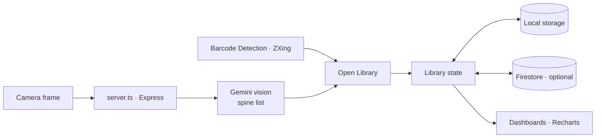

<div align="center">



<p>
  
  
  
  
</p>

<p><em>A React app that bridges your physical bookshelf and your reading habits.<br>
Scan a shelf or a barcode, log your sessions and watch your library and streaks grow.</em></p>

</div>



## Features

| | |
|---|---|
| **Shelf scanner** | Point the camera at a shelf; a server-side Gemini vision endpoint returns every readable spine. |
| **ISBN / QR scanner** | Live barcode decoding resolved against the Open Library catalogue. |
| **Catalogue search** | Debounced Open Library search for manual entry and low-confidence spines. |
| **Smart pacing** | The exact time left to finish a book, from the seconds you log per percent. |
| **Streaks and milestones** | Consecutive reading days with animated milestone toasts. |
| **Library and shelves** | Unread, Reading and Read, custom shelf strips, filters and sorting. |
| **Recommendations** | New titles suggested from the authors and genres you already own. |
| **Dashboards** | A monthly goal ring, weekly reading lines and library growth. |
| **Ambient reading mode** | A full-screen timer with rain, fireplace and library soundscapes synthesised in Web Audio. |
| **Cloud sync** | Optional Google sign-in with Firestore and a timestamp-based merge. |


## How it fits together




## Türkçe özet

**BookShelf**, fiziksel kitaplığını dijitalleştirip okuma alışkanlıklarını takip etmeni sağlayan bir React uygulaması. Kamerayı rafa tutunca Gemini görüş modeli kitap sırtlarını okuyor; barkod okutarak da kitap eklenebiliyor. Okuma süresine göre kitabı bitirmene ne kadar kaldığını hesaplıyor, günlük seri ve aylık hedef grafikleri tutuyor, ortam sesli bir okuma modu sunuyor. Google ile giriş yapıp eşitleme isteğe bağlı; arayüz Türkçe ve İngilizce.


## Development

```sh
npm install
cp .env.example .env.local   # GEMINI_API_KEY, Firebase config
npm run dev                  # Express + Vite
npm test                     # vitest
npm run build && npm start
```

```
src/components/   scanner, library, shelves, dashboards, reading mode
src/services/     Open Library, Gemini client, sync, storage
src/i18n/         Turkish and English
src/server/       vision endpoint
src/__tests__/    unit and component tests
```

<div align="center">
<br>
<a href="https://github.com/kutluhangil"></a>
<sub>For the books you own and the ones you are still reading.</sub>
</div>
